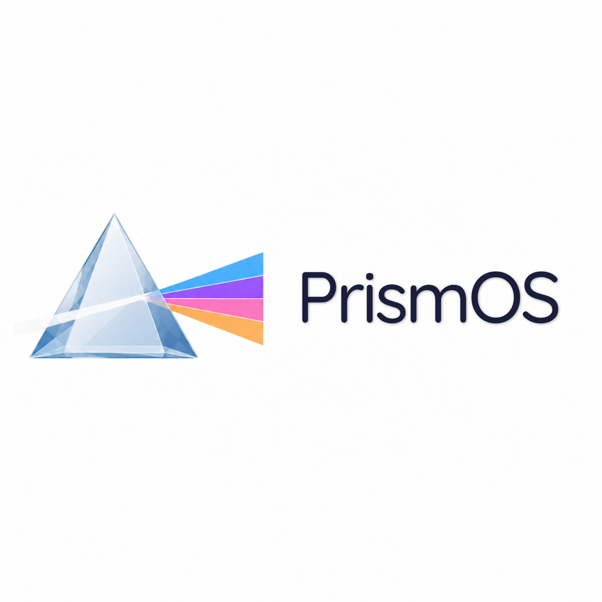

# PrismOS — どこでもカスタムできる OS



> **中央寄せのモダンな UI、Dock と横断検索、2 つの体系のシェル。**
> テーマ・壁紙・タスクバーの位置は `config/theme.toml` で変えられる。

PrismOS は、見た目も動きも自分好みに変えられる OS を目指すプロジェクトです。
最初の製品版は **27H1（2027年度上半期）** に出す予定です。
開発版は v0.1 → v0.9 と進み、v1.0 到達をもって製品版とします。

v0.1 は「QEMU で起動して、シリアル経由のシェルが動く」最小カーネルです。
GUI は後のフェーズで、設計は `docs/DESIGN.md` にあります。
製品版の仕様はすべて `docs/PRODUCT_v1.0_SPEC.md` にまとめてあります。

**公式ページ**: [PrismOS 27H1 公式ページ](https://maigotaisakuservice-spport-of-pcking.github.io/PrismOS/)
（`docs/index.html`。ダウンロード・インストール手順・最初の一歩・既知の問題はこちらが正本です。
リリースノートは `docs/RELEASE_NOTES_27H1.md`）

## 製品版で目指すもの

- **デスクトップ:** モダンなスタート・タスクバー（既定は左寄せ）と、Dock・横断検索・ウィンドウ一覧。Dock は最初から表示する。ウィジェット（天気・ニュース・カレンダー）も出す
- **標準アプリ:** 自作ブラウザ「Prism Browser」（Chromium ではなく一から作るエンジン、既定の検索は Google）、独自オフィス「Prism Office」（Office 形式とも互換）、メール・カレンダー・連絡先・メモ・時計、写真・動画・音楽プレイヤー、3D シューティングゲームとトランプ
- **ストア:** 「Prism Store」。アプリは無料だけ。配信・出品するのはこちら（PrismOS 側）のみ
- **アップデート:** セキュリティ更新は自動、機能更新は手動で分ける。ベータチャンネルも選べて、安定版に戻れる。失敗したら自動で前の版に戻る。配信元は GitHub Releases のみ。バージョン番号は年号形式の `27H1`
- **セキュリティ:** 市役所レベルの Enterprise レベルを標準で適用する。変更は管理者権限があるアカウントだけができる
- **互換性:** Wine のように、他の OS のアプリをそのまま動かす互換層を目指す。他の OS のアプリ（.app / .dmg）も対象
- **その他:** アカウントはローカルのみ。言語は日本語と英語から選べる。ARM 版も x86 版と同じタイミング・同じ機能で出す。デュアルブート版の ISO は別で作る

## v0.2.0 でできること

- Limine 8.3.2 でブートし、QEMU で起動する
- 起動バナーをシリアル (COM1) に出す
- シリアルシェルで 2 つの体系のコマンドを使う
- デスクトップ (フレームバッファ描画、タスクバー、Dock、横断検索) と 16 つの画面アプリ (ターミナル、ファイル、設定、ブラウザ、メモ、カレンダー、写真、音楽、カード、シューティング、表計算、動画、インストーラー、メール、文書、プレゼンテーション)
- インストーラーアプリ (Ctrl+I で開く。パーティション画面でディスクの機種名・大きさ・パーティション一覧を表示、自動／データパーティション／ディスク全体の選択、標準構成と最小構成（ブラウザ・ファイル管理・設定だけ）の選択、進捗表示、インストール後のファイル検証、完了後の再起動案内。最小構成で入れると Dock は 4 つのアプリだけになる)
- 表計算アプリ (Ctrl+O で開く。10 列 × 20 行、数値・文字列・数式、四則演算・セル参照・SUM/AVG/MIN/MAX、保存は `sheet.csv` に、`s` で保存・`l` で読み込み)
- 動画アプリ (Ctrl+V で開く。320x240 の圧縮動画 `vid-01.pv1` から `vid-24.pv1` の 24 フレームを 4 fps で再生。音声つき。Space で再生・停止、左右キーでシーク、`n`/`p` で 1 フレーム移動、`r` で最初に戻る。古い BMP 連番 `vid-*.bmp` も引き続き読める)
- キーボードとマウス (PS/2) での入力
- ディスクへの永続化とインストーラー、PIN ログイン、ファイル暗号化、ディスク単体起動
- ネットワーク (e1000 + DHCP + DNS + TCP + HTTP)
- 3D シューティングゲーム (レイキャスティング、F12 で開く)
- デュアルブート (第2の ISO `prismos-dualboot.iso` とデュアルブート用ディスク、起動メニューで 2 つのシステムを選択、`install dual yes` でデータパーティションだけにインストール)
- メールアプリ (Ctrl+M で開く。`mail setup <smtp_host> <smtp_port> <pop3_host> <pop3_port> <user> <pass> <from>` でサーバーを設定、SMTP で送信・POP3 で受信、一覧・閲覧・削除ができる。受信したメールは `mail-NNNN.txt` としてディスクに保存され、再起動後も残る。シェルからも `mail` / `mail send <to> <subject> <body...>` / `mail recv` / `mail read <n>` / `mail del <n>` が使える。TLS 1.2 対応（自前実装、証明書はサーバ証明書の SHA-256 フィンガープリントによるピン留めで検証し、一致しなければ接続しない。`mail tls <host> <port>` でフィンガープリントを取得して設定する）。IMAP 受信にも対応（`mail imap <n>`）。パスワードはディスク鍵で暗号化して保存する)
- 文書アプリ (Ctrl+D で開く。見出し・箇条書き・番号付き・太字の書式つきで編集でき、`doc.txt` に保存。`\` + `1`/`2`/`3`/`-`/`0` で行の書式を変える。Ctrl+E で本物の .docx ファイル (`doc.docx`) に書き出し、Ctrl+R で読み込む。外部の .docx も小さいものなら読める)
- プレゼンテーションアプリ (Ctrl+P で開く。タイトルと箇条書きのスライドを 8 枚まで作れて、`slides.txt` に保存。Tab で項目を移動、Enter で箇条書きを追加、Ctrl+N で新しいスライド。Ctrl+P でスライドショーになり、左右キーでスライドをめくる。Ctrl+E で本物の .pptx ファイル (`slides.pptx`) に書き出し、Ctrl+R で読み込む。外部の .pptx も読める。短いスライド 8 枚まで書き出せる（16384 バイトのファイル制限に収まる範囲）)
- セキュリティ強化 (PIN ハッシュを SHA-256 の反復ハッシュ 10000 回・16 バイトソルトに強化。古いアカウントでログインすると新しい形式に自動で移行する。乱数は RDRAND（あれば使う）とキー・マウス・時刻を混ぜたものに強化。`security` コマンドで外部メディアの許可／禁止・PIN の最小長と数字必須・ロックアウトの回数と秒数・アプリの許可リスト・リモートロック／ワイプの設定ができ、変更には管理者 PIN が要る。`audit` / `audit verify` でハッシュチェーンつきの監査ログを確認できる。設定画面にもセキュリティの概要が出る。指紋・顔認証はまだ無い)
- 互換レイヤー (他のOS向けに作られた小さな静的ELF実行ファイルを動かす。`run <file> [args...]` で実行し、`compat info <file>` / `compat list` / `compat calls` で確認できる。対応する呼び出しは exit・write・read・open・close・fstat・brk・getpid の 8 つで、未対応の呼び出しは -38 (ENOSYS) を返して正直に知らせる。ファイルマネージャーで .elf ファイルを開くとそのまま実行できる。実証アプリ hello.elf / calc.elf / cat.elf / unsup.elf が組み込み済み。動的リンク・グラフィック・ネットワーク・GUIを使うアプリは未対応)
- シェルに `cp` / `mv` を追加（ファイルのコピー・移動・名前変更ができる）。シェルの 1 行は 512 文字まで入力できる。`help` には日本語の説明がついている（画面のフォントは英数字だけのため、日本語はシリアルでのみ読める）
- ブラウザにアドレス入力欄を追加（初期値は example.com。入力して Enter でそのホストを取得する。取得自体は平文 HTTP のまま）
- 設定アプリで Dock の表示／非表示を切り替えられる（`k`）。アクセント色は 4 色（水色・紫・桃・緑）。横断検索（F8）は 32 件まで結果を出す
- メールアプリの本文は 4096 バイトまで入力できる（従来は 1024 バイト）。送信は SMTP、受信は POP3 と IMAP。TLS 1.2 対応（証明書ピン留め）
- ARM カーネルが起動する (`make arm-kernel` で `build/kernel-arm.elf` を作り、`make arm-boot-test` で QEMU の virt 構成で起動を確認。AArch64 の入口（EL3/EL2/EL1 から EL1 へ落とす）、PL011 UART、GICv2、汎用タイマ（10ms 間隔の割り込み）、MMU（恒等写像）があり、x86 版と同じシェルコアで help / ver / ls / cat / echo / rm / touch / cd / pwd / theme / reboot が動く。ARM だけの `mem` / `ticks` コマンドもある。`reboot` は PSCI リセットで QEMU が終了する。ARM の画面は ramfb で 1024x768 が出るようになった（fw_cfg DMA 書き込みで設定を送る。`make arm-screen-test` で壁紙・プリズム・タスクバーを確認）。デスクトップ・ファイルシステム・ネットワーク・ディスク・画面アプリはまだ ARM では動かない)
- 回復モード (起動時の R キーか `recovery` コマンドで入る。データを残して修復、復元ポイントから復元、初期化、前のバージョンをダウンロードして壊れたファイルだけ修復の 4 つ。`snapshot` コマンドで復元ポイントを作れる)
- 更新システム (セキュリティ更新の自動適用、機能更新の手動適用、安定版／ベータのチャンネル選択、差分更新、失敗時の自動ロールバック。`update check` / `update apply [yes]` / `update channel <stable|beta>` / `update auto <on|off>` / `update server <host> [path]` / `update rollback`)
- 耐量子暗号 (更新ファイルの署名に ML-DSA-44、将来の鍵交換に ML-KEM-512/768/1024 を純粋Cで実装。更新マニフェストは `<path>.sig` (2420 バイト) の署名つきで配り、署名のないもの・改ざんされたものは拒否する。鍵生成・署名はホスト側ツール (`scripts/pq-sign.py`) で、検証はカーネル側で行う。ファイル暗号化の AES-256 と SHA-256 は量子耐性があるためそのまま。ML-KEM-512 は公開ライブラリに同サイズの検証用クラスが無いため一貫性と改ざん検出のみ確認し、768/1024 は公開ベクトルと一致することを確認済み)
- ドライバー (AHCI SATA ディスクと virtio ブロックデバイスに対応。QEMU の q35 構成の AHCI コントローラと virtio-blk から読み書きでき、`disk` コマンドで種類・機種名・容量を確認できる。`install` とファイルの永続化が AHCI ディスクでも virtio-blk ディスクでも動く（再起動後もファイルが読める）。USB は UHCI ホストを初期化してデバイスを列挙でき、`usb` コマンドでベンダ／プロダクト ID と種別を表示する。QEMU に USB キーボードと USB マウスを付けると 2 台の HID 機器として列挙される。USB キーボード／マウスからの入力と USB メモリの読み書きはまだ無い)
- 受入チェックリストの検証機構 (`scripts/checklist-test.py`、`make checklist` で実行。仕様書 §6 の 13 項目を本物の測定で確認し、合格／不合格／未検証を分けて `build/checklist-result.txt` に書く。ISO のチェックサムと ML-DSA 署名は `make iso-sign` で作る)
- 起動画面に公式ロゴ（明るい版）を表示する。インストーラーの「ディスク全体」は、起動可能なディスクを作れない場合は理由つきで断る（空ディスクでの確認を `make installer-test` に追加）

| やりたいこと | `ls` 系 | `dir` 系 |
|---|---|---|
| ファイル一覧 | `ls` | `dir` |
| ファイル表示 | `cat README.txt` | `type README.txt` |
| 画面クリア | `clear` | `cls` |
| バージョン | `ver` | `version` |

そのほか `pwd` `cd` `echo` `cp` `mv` `help` `about` `theme` `reboot` が使えます。

## ビルド方法

必要なもの: `gcc` `make` `curl` `xorriso` `mtools`、QEMU を使う場合 `qemu-system-x86`

```sh
# Ubuntu / Debian の例
sudo apt-get install -y gcc make curl xorriso mtools qemu-system-x86

# カーネル + ISO を作る (Limine 8.3.2 は自動でダウンロードされる)
make

# シェルのユニットテスト (ホスト側、QEMU 不要)
make test

# QEMU で起動する
make run

# QEMU で起動してバナーとシェルを自動で確認する
make boot-test
```

成果物: `build/kernel.elf`、`build/prismos.iso`

## 構成

```
PrismOS/
├── kernel/          C の最小カーネル (main, シリアル, シェルラッパー, Limine)
│   └── limine.h     Limine 8.3.2 のヘッダ (ベンダリング済み)
├── shell/           2体系対応シェルのコア (カーネルとテストで共有)
├── config/
│   └── theme.toml   テーマ・壁紙・タスクバー・Dock の設定例
├── docs/
│   ├── DESIGN.md              アーキテクチャとフェーズ計画
│   └── PRODUCT_v1.0_SPEC.md   製品版 v1.0 の仕様書
├── tests/           シェルパーサーのホストテスト
└── .github/workflows/build.yml   ビルド + QEMU 起動テスト (GitHub Actions)
```

## カスタマイズ

`config/theme.toml` を編集すると、将来の GUI が読む設定を変えられます。
v0.1 ではシェルの `theme` コマンドがこのファイルの内容を表示します。

```toml
[theme]
accent = "#4CC2FF"          # アクセントカラー
wallpaper = "prism-dusk.png"
taskbar_position = "bottom" # top / bottom / left / right
```

詳しくは `config/theme.toml` と `docs/DESIGN.md` を見てください。

## ロードマップ

- **v0.1**: 最小カーネル + Limine ブート + シリアルシェル
- **v0.2 (完了)**: キーボード入力、メモリ管理、ファイルシステムの土台
- **v0.2 フェーズ4 (完了)**: ディスクへの永続化、インストーラー、ログインの土台
- **v0.2 フェーズ5 (完了)**: ネットワーク（e1000 + DHCP + DNS + TCP + HTTP）と画面アプリ（ブラウザ・メモ・カレンダー）
- **v0.2 フェーズ6 (完了)**: ディスク単体起動、PS/2 マウス、壁紙画像、横断検索、ファイル暗号化
- **v0.2 フェーズ7 (完了)**: バージョン 0.2.0、写真アプリ（BMP）、音楽アプリ（SB16 で WAV 再生）、カードゲーム（ブラックジャック）
- **v0.3 (完了)**: フレームバッファ描画、壁紙、タスクバー、Dock、画面アプリ（ターミナル・ファイル・設定）
- **v0.2 フェーズ8〜19 (完了)**: 3D シューティング、デュアルブート、回復モード、更新システム、表計算、動画、メール、文書・プレゼンテーション、セキュリティ強化、動画コーデック、互換レイヤー、ARM カーネル、耐量子暗号、ドライバーと安定化
- **5 種ビルド + サンドボックス (完了)**: 64bit / 32bit / ARM / Live ブート (USB) / 仮想環境の 5 種のビルドと、互換ゲストのサンドボックス
- **残りの制限フェーズ (完了分まで)**: ショートカット GUI 編集、メール TLS/IMAP、USB 入力・ストレージ、耐量子の鍵共有と署名、動的リンク、監査ログ改善、日本語フォント、生体認証のソフトウェア側、UI (ウィンドウ、クリップボード、右クリックメニュー、通知、Dock 設定、ランチャー)、言語選択、ドライバ後付けの仕組み、ARM の対話操作
- **製品版 27H1 に向けて**: 残りのドライバ (NVMe、xHCI、Wi-Fi 等)、Prism Store、標準アプリの不足分、内蔵アプリの隔離、8 時間連続動作テスト、GitHub Actions での確認
- **27H2 (大型アップデート)**: Win32 互換の本格化。PE ローダ → コンソール系 API サブセット → GUI アプリ対応 → 対応範囲の拡大の順に段階的に実装し、到達できた対応範囲は正直に報告する
- **v0.7**: セキュリティ本格化（サンドボックス、権限、署名付き更新。ファイル暗号化は v0.2 フェーズ6 で済み）
- **v0.8**: 標準アプリ完成（Prism Browser、Prism Office、写真、音楽。メール・文書・写真・動画・音楽・ゲームは未実装）
- **v0.9**: インストーラー、バックアップ、復旧、安定性の仕上げ
- **27H1 (製品版 v1.0)**: この仕様書の全項目を満たし、日常利用レベルで使えること

開発版 v0.2〜v0.9 は GitHub Releases には出しません。製品版 27H1 まで待ちます。

## Q&A（よくある質問）

サポートはこの README の Q&A のみです。チャットや電話でのサポートはありません。

**Q. PrismOS はどんな OS ですか？**
A. 中央寄せのモダンな UI、Dock と横断検索、2 つの体系のシェルを持ち、どこでもカスタムできる OS です。最初の製品版は 27H1 です。

**Q. 今の v0.2.0 で何ができますか？**
A. QEMU で起動して、シリアルシェルで `ls` / `dir` などのコマンドが使えます。デスクトップもあり、ターミナル・ファイル・設定・ブラウザ・メモ・カレンダー・写真・音楽・カード・シューティング・表計算・動画・インストーラー・メール・文書・プレゼンテーションの 16 つのアプリが動きます。文書アプリとプレゼンテーションアプリ（Prism Office）で .docx/.pptx の読み書きもできます。

**Q. どうやってビルドしますか？**
A. 上の「ビルド方法」を見てください。`make test` でシェルのテスト、`make boot-test` で QEMU の起動テストができます。

**Q. 他の OS のアプリは動きますか？**
A. 製品版では Wine のような互換層で動かすのが目標です。v0.1 ではまだ動きません。

**Q. インストールはどうしますか？**
A. 製品版では USB からインストールできます。通常版とデュアルブート版の ISO を 2 種類作ります。

**Q. 起動テストが失敗したら、どうやって原因を調べますか？**
A. GitHub Actions の実行ページから `boot-log` アーティファクトをダウンロードすると、`build/boot.log`（QEMU のシリアル出力全文）が見られます。ローカルでは `make boot-test` のあと `cat build/boot.log` で同じものが見られます。

**Q. 更新はどうやって届きますか？**
A. GitHub Releases から届きます。セキュリティ更新は自動、機能更新は手動で、失敗したら自動で前の版に戻ります。

## ライセンス

MIT License — `LICENSE` を参照。
